# AI-HUB 智能测试工作台

> AI 驱动的一站式软件测试平台：需求进、用例出，覆盖生成 → 评审 → 入库 → 报告全流程。

[](backend/) [](frontend/) [](docs/USER_GUIDE.md) [](docs/TECHNICAL.md)

### 🚀 在线 Demo（GitHub Pages）

**👉 [打开在线 Demo：snow-sakura.github.io/ai-test-hub](https://snow-sakura.github.io/ai-test-hub/)**

Demo 完全运行在 GitHub 上：静态站点由 **GitHub Pages** 托管（域名 `*.github.io`），
部署流水线由 **GitHub Actions** 自动完成，演示数据保存在 **GitHub Gist** 中
（Demo 页可直接读写自己的 Gist 作为「生成记录」存储），无需本地环境与任何数据库。

## ✨ 核心特性

- **AI 用例生成**：粘贴需求或上传 PDF/Word/MD → 流式输出「分析 → 生成 → 评审 → 改进」四阶段产物 → 存入用例库 / 导出 Excel。
- **生成序列（批量）**：一次提交 N 行需求，每条独立任务；**序列看板** 实时展示 完成/进行/排队位次，随时单独取消。
- **计费类型调度**：模型标记 `免费` → 全局单任务**严格串行**（防限流）；标记 `付费` → 最多 4 任务**并行**生成。
- **可靠流式**：SSE 断线自动重连 + 事件回放（StreamBroker），刷新页面不丢进度；进程重启自动回收僵尸任务。
- **多模型接入**：DeepSeek / 通义千问 / OpenAI 及任意 OpenAI 兼容服务；密钥数据库密文 + 环境变量双级回退，内置 Mock Server 可离线体验全流程。
- **完整测试平台**：用例管理与评审、API 接口测试、AI 聊天室、知识库 RAG、用户/角色/审计的系统管理。

---

## 🎬 全流程操作演示

> 每一步都给出：**主标题**（做什么）→ **副标题**（在哪一步）→ **说明**（怎么做、看到什么）→ **截图**。

### 步骤 1 · 登录并进入工作台

**副标题：系统入口 · 身份认证与首页仪表盘**

使用平台默认账号 `admin / admin123` 登录。登录后进入首页仪表盘，顶部导航可切换中文/英文，
右上角显示当前用户；首页汇总项目数、用例数、今日执行与通过率，点击卡片进入对应模块。

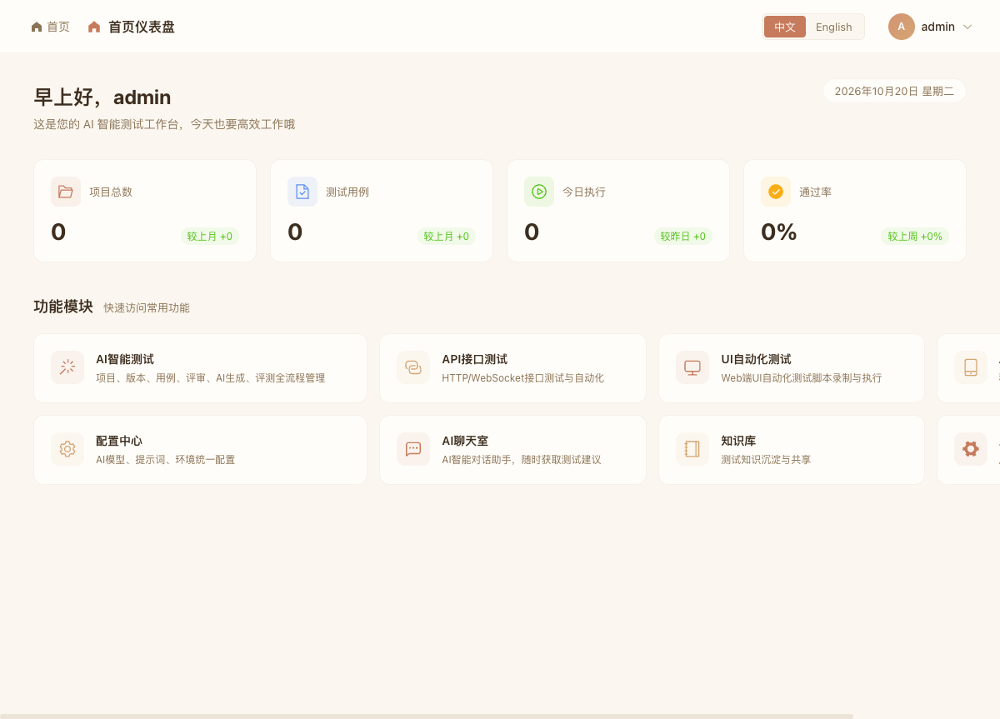

### 步骤 2 · 查看 AI 智能测试总览

**副标题：AI 智能测试 · 测试总览看板**

左侧 `AI智能测试` 菜单进入「测试总览」：展示项目/用例/成员/待评审数量、近 7 天用例趋势、
优先级分布与快速入口。下方「最近活动」记录团队协作轨迹，作为质量管理的统一入口。

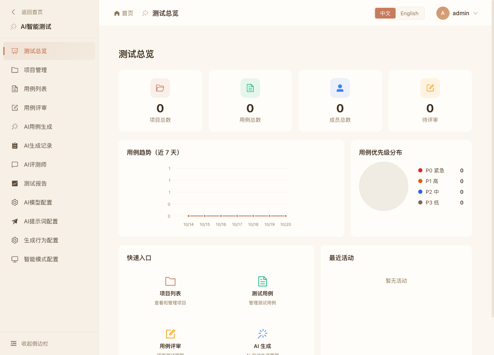

### 步骤 3 · 配置 AI 模型与计费类型

**副标题：配置中心 · 模型即调度策略**

进入「AI模型配置」→ 新建/编辑模型：填写名称、类型、角色（writer/reviewer）、Base URL、API Key，
并新增 **计费类型**：

- `免费（任务串行执行）` → 该模型提交的批量需求 **严格排队**、一次只跑一个，避免触发限流；
- `付费（任务并行执行）` → 批量需求 **并行** 生成，默认最多 4 路并发（`PAID_MODEL_CONCURRENCY`）。

列表中的「计费类型」列以标签直观呈现当前策略。API Key 仅做脱敏展示（`sk-****abcd`），
后端不会把脱敏值写回数据库，真实密钥只保存在数据库/环境变量中。

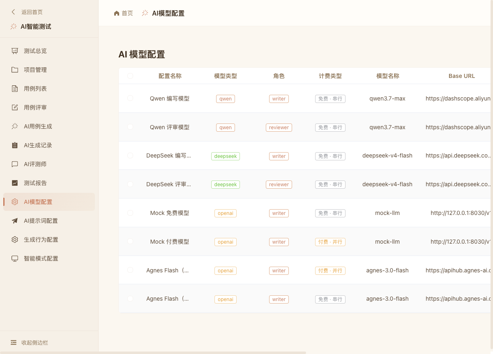

### 步骤 4 · 单任务 AI 用例生成（四阶段流式）

**副标题：AI用例生成 · 需求分析 → 用例编写 → AI 评审 → 改进完善**

在「AI用例生成」页粘贴需求或上传需求文档，选择**编写模型**、**提示词**、**是否自动评审**与**管线类型**
（传统管线 / LangGraph），点击「开始生成」：

1. **需求分析**：拆解功能模块、核心流程、边界条件；
2. **用例编写**：产出 7 列 Markdown 用例表（编号/模块/标题/前置条件/步骤/预期/优先级）；
3. **AI 评审**：9 维度打分并给出问题清单；
4. **改进完善**：按评审意见修订并输出最终用例。

右侧「生成进度」按阶段循环推进，实时日志逐条打印；下方「生成结果」展示结构化用例表，
可一键**保存到用例库**或**导出 Excel**。

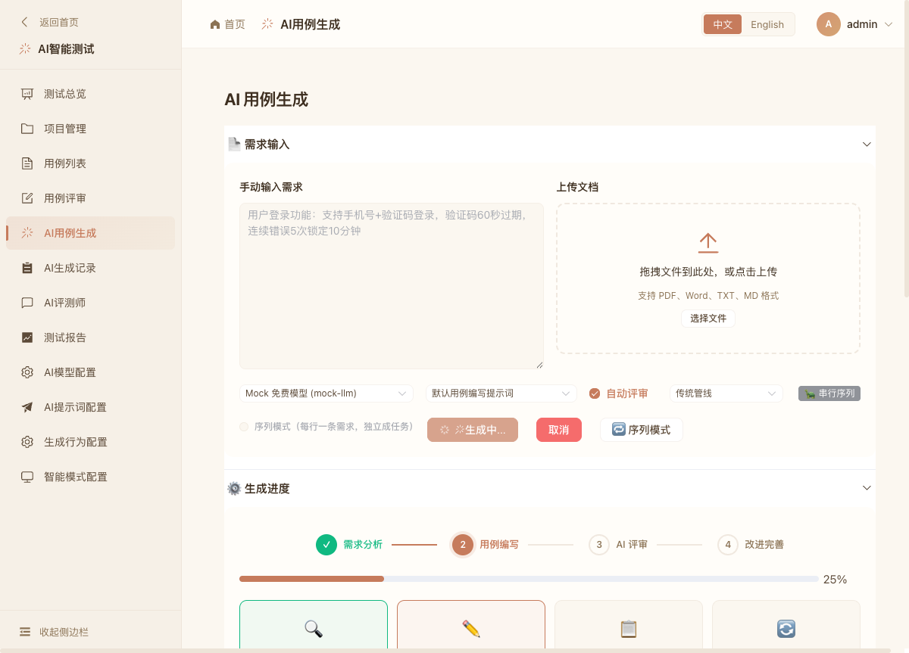

生成完成后，结果以表格形式呈现（可保存/导出）：

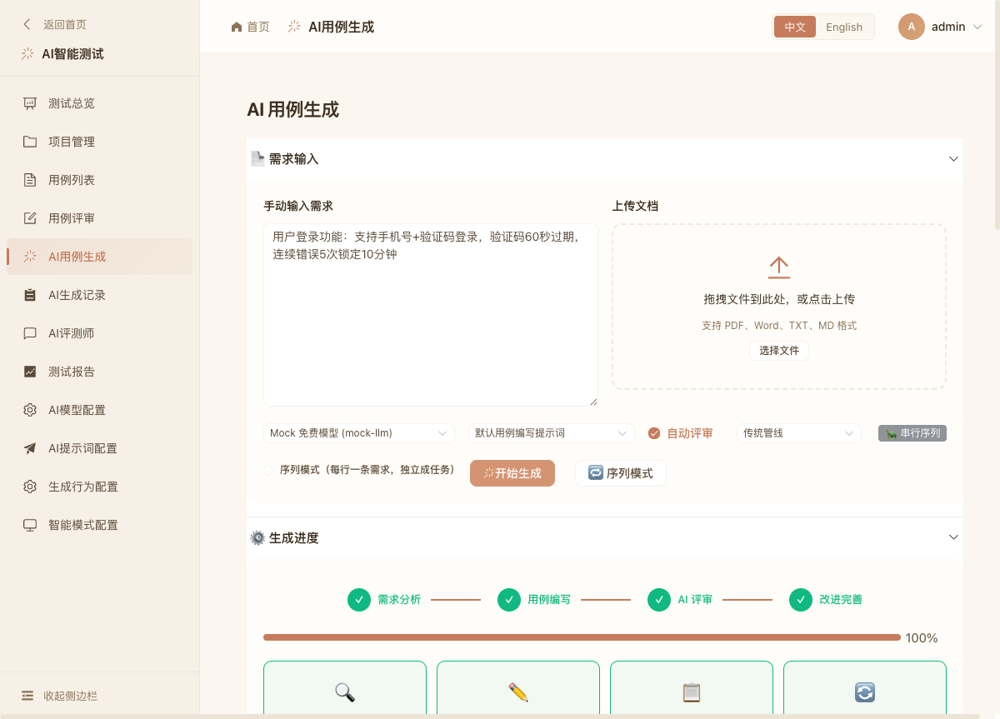

### 步骤 5 · 生成序列（批量）与计费差异化调度

**副标题：生成序列看板 · 免费串行 / 付费并行**

勾选「**序列模式（每行一条需求，独立成任务）**」，输入多条需求后提交「提交生成序列（N 条）」：

- 选择 **免费模型** → 看板显示 `免费模型 · 单任务序列（严格串行）`，第 1 条运行、其余显示
  **排队第 X 位**，完成后自动递补下一条；
- 选择 **付费模型** → 看板显示 `付费模型 · 并行执行（最多 4 路）`，多条需求同时进入
  需求分析/编写阶段，总耗时显著缩短。

看板实时给出 完成/进行/排队/失败 计数、每条任务的进度与用例数，完成后可直接点「查看」进入详情。

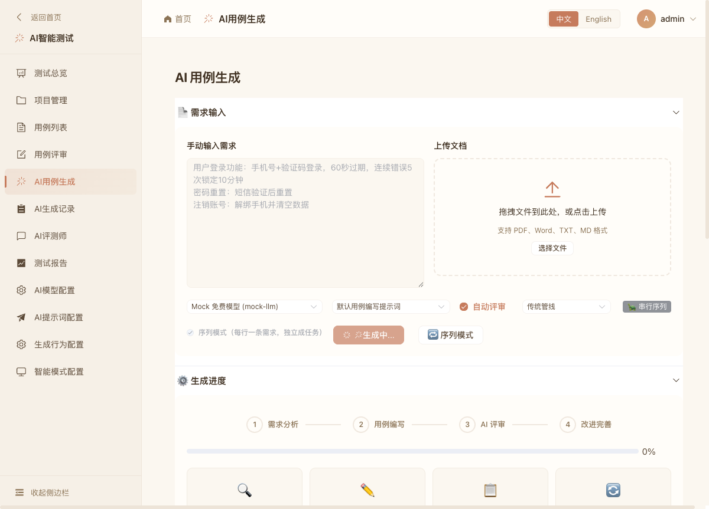

序列全部完成后的看板：

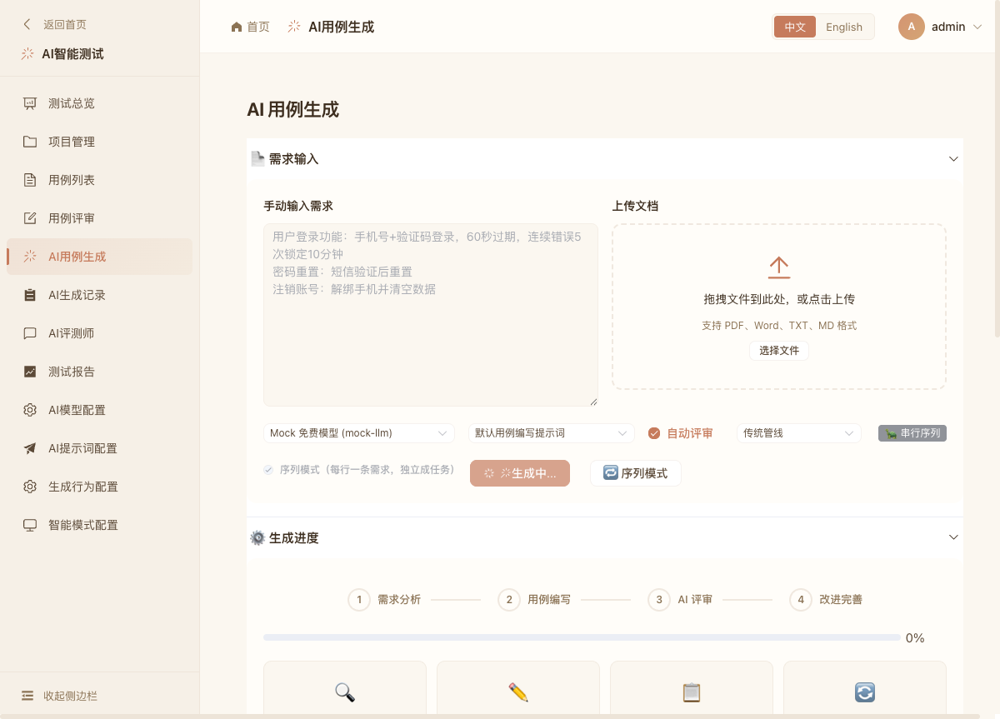

### 步骤 6 · 生成记录与任务详情

**副标题：AI生成记录 · 服务端分页与阶段回放**

「AI生成记录」页按服务端分页展示所有任务，支持**状态筛选**（排队中/生成中/评审中/已完成/失败…）
与**关键词搜索**；点击「查看」进入任务详情，可回看需求分析、评审反馈、改进结果与候选用例，
并对候选用例执行**批量采纳 / 批量丢弃 / 保存到用例库**。

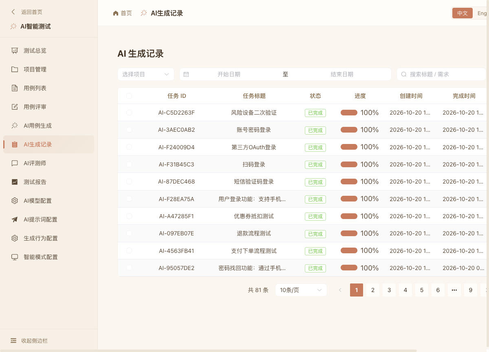

### 步骤 7 · 用例库管理与评审闭环

**副标题：测试资产沉淀 · 用例列表 → 用例评审**

生成的用例保存后进入「用例列表」，可按项目/版本/优先级/状态检索并维护；
「用例评审」提供评审单、评审人与评审结论管理，形成 需求 → 用例 → 评审 的闭环。

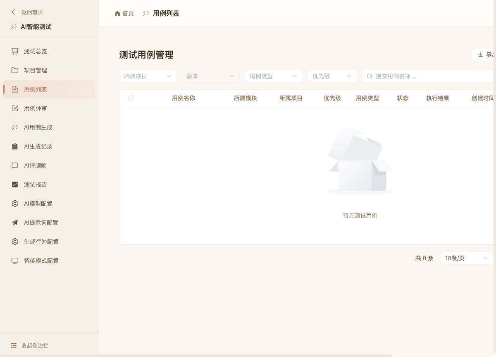

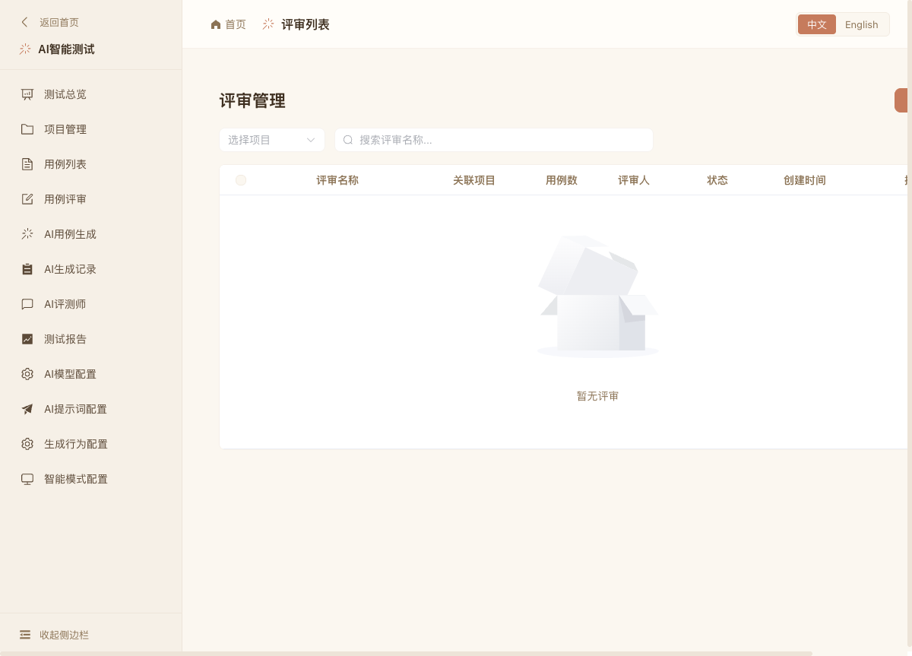

### 步骤 8 · API 接口测试与 AI 辅助

**副标题：多形态测试 · API 测试 / AI 评测师 / 聊天室**

「API 接口测试」管理接口、环境与定时调度；「AI 评测师」以会话方式与模型讨论测试策略；
「AI 聊天室」与「知识库 RAG」提供通用问答与文档检索，均复用同一套模型配置与密钥解析链。

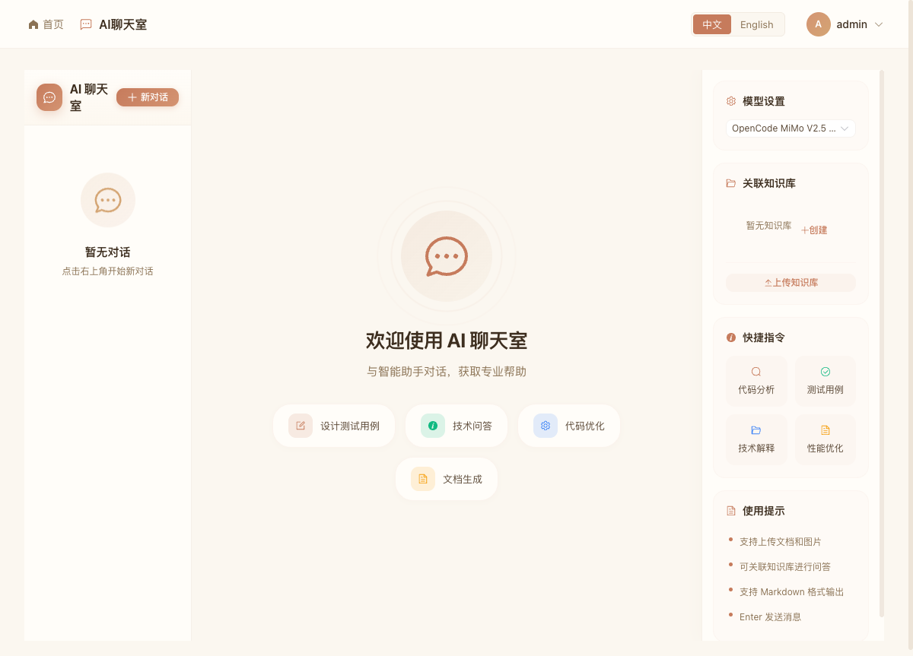

---

## 🧱 技术栈

| 层 | 技术 |
|----|------|
| 后端 | Python 3.12+ · FastAPI · SQLAlchemy 2.0 (async) · LangChain/LangGraph · Alembic |
| 前端 | Vue 3.5 · TypeScript · Vite · Element Plus · Pinia · vue-i18n |
| 基础设施 | MySQL 8 · Redis 7 · Docker Compose |
| Demo | GitHub Pages · GitHub Actions · GitHub Gist |

## 🚀 快速开始

```bash
git clone git@github.com:snow-sakura/ai-test-hub.git && cd ai-test-hub

# 1. 基础设施（MySQL 3306 / Redis 6379）
docker compose up -d mysql redis

# 2. 后端
cd backend
python3 -m venv .venv && source .venv/bin/activate
pip install -r requirements.txt
cp .env.example .env                 # 填写数据库连接与 AI API Key（可留空用 Mock）

python scripts/init_db.py            # 建库建表 + 迁移基线
python scripts/seed_demo.py          # 演示数据：管理员/模型配置/提示词（幂等）

# 3.（可选）Mock LLM —— 无需真实 Key 体验全流程
python scripts/mock_llm_server.py    # 新开终端，监听 127.0.0.1:8030

# 4. 启动后端 http://localhost:8000/docs
uvicorn app.main:app --reload --port 8000

# 5. 启动前端
cd ../frontend && npm install && npm run dev
```

默认账号 `admin / admin123`（来自 seed）。无真实 API Key 时，在生成页选择 **Mock**– 开头的模型即可完整体验 并行/串行 调度与序列看板。

## 📖 文档

| 文档 | 内容 |
|------|------|
| [使用手册](docs/USER_GUIDE.md) | 登录、模型配置、单任务生成、生成序列、记录与 FAQ |
| [技术文档](docs/TECHNICAL.md) | 架构、生成管线、执行调度器与 StreamBroker、迁移策略 |
| [需求文档](docs/REQUIREMENTS.md) · [技术规格](docs/SPEC-v1.1.md) | 产品需求与规格 |

## 🗂 项目结构

```
ai-test-hub/
├── backend/
│   ├── app/
│   │   ├── main.py          # 入口 + lifespan（僵尸恢复/调度器关闭）
│   │   ├── common/          # 认证、响应模型、AI 客户端、时间约定
│   │   └── modules/         # 业务模块四层 api/models/schemas/services
│   │       ├── aitest/      # AI 测试核心：生成/评审/调度器/管线
│   │       ├── api_testing/ # 接口测试
│   │       └── ...          # chat / knowledge / system 等
│   ├── scripts/             # init_db.py / seed_demo.py / mock_llm_server.py
│   └── alembic/
├── frontend/src/            # views/modules 按业务模块组织 api/ stores/ composables/
├── demo/                    # GitHub Pages 纯静态 Demo（数据存于 GitHub Gist）
├── docs/                    # 文档与截图
└── docker-compose.yml
```

## ⚙️ 环境变量（backend/.env 关键项）

| 变量 | 说明 |
|------|------|
| `DATABASE_URL` | 如 `mysql+aiomysql://<user>:<password>@localhost:3306/ai_hub_test` |
| `REDIS_URL` | 如 `redis://:<password>@localhost:6379/0` |
| `SECRET_KEY` | JWT 签名密钥 |
| `DEEPSEEK_API_KEY` / `QWEN_API_KEY` / `OPENAI_API_KEY` | 数据库配置缺失时的回退 Key |
| `PAID_MODEL_CONCURRENCY` | 付费模型并行上限（默认 4） |

> ⚠️ `.env`、`*.sqlite3`、`backend/uploads/` 等敏感与运行时文件均已在 `.gitignore` 中忽略，不会进入仓库。

## 🔐 GitHub Pages Demo

| 项 | 说明 |
|----|------|
| 站点 | <https://snow-sakura.github.io/ai-test-hub/> |
| 源码 | [`demo/`](demo/) —— 纯静态（HTML/CSS/JS），无构建依赖 |
| 部署 | `.github/workflows/deploy-pages.yml`：push 到 `main` 且 `demo/**` 变更时自动发布 |
| 数据 | 演示数据保存在 **GitHub Gist**（Demo 页内可保存/读取自己的 Gist 作为生成记录） |

## 🧭 版本规划

| 版本 | 内容 | 状态 |
|------|------|------|
| v0.1.0 | 基础架构 + AI 用例生成核心 | ✅ 已发布 |
| v0.2.0 | 生成序列调度 + 计费策略 + 接口测试完善 | ✅ 当前 |
| v0.3.0 | UI 自动化 + 知识库增强 | 📋 计划中 |
| v0.4.0 | APP 自动化 + 通知系统 | 📋 计划中 |

## 许可证

私有项目，保留所有权利。
