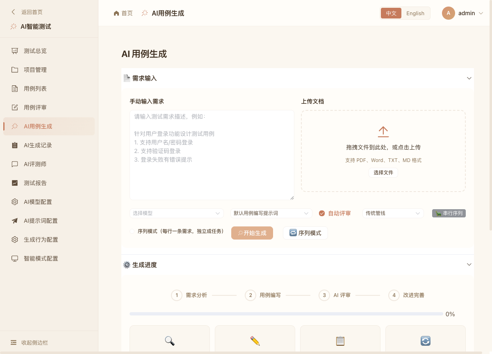

# AI-HUB 使用手册

> 面向测试工程师的使用指南。截图见 `docs/images/`。配套：[技术文档](TECHNICAL.md) · [README](../README.md)

## 0. 登录

浏览器打开平台地址，使用账号登录（演示环境：`admin / admin123`）。

登录后首页展示各测试模块入口：AI 智能测试、接口测试、UI 自动化等。


## 1. AI 模型配置（管理员）

路径：`AI 智能测试 → AI模型配置`（或 `配置中心 → AI模型`）。


| 字段 | 说明 |
|------|------|
| 配置名称 | 自定义名称，生成页下拉选择时展示 |
| 模型类型 | DeepSeek / Qwen / OpenAI / 兼容 OpenAI 协议的其他服务 |
| 角色 | 该配置用于哪类提示词（编写/评审/分析/改进） |
| **计费类型** | **免费**＝排队串行执行（避免限流）；**付费**＝多任务并行执行 |
| Base URL | OpenAI 兼容地址（自动补 `/v1`），如 `https://api.deepseek.com` |
| API Key | 保存后以 `****` 掩码回显；留空则回退服务器环境变量 |

> 💡 同一模型可以同时建「免费」「付费」两条配置，按需切换执行策略。

**付费模型的并行度**：默认 4 路并发，可在 `backend/.env` 中调整：

```bash
PAID_MODEL_CONCURRENCY=6   # 允许最多 6 个付费任务同时生成
```

修改后重启后端生效；免费模型始终固定为 1（严格串行），不受该配置影响。

**Mock 模型（离线体验）**：`scripts/seed_demo.py` 会写入 `Mock 免费模型` / `Mock 付费模型`
两条配置，指向本地 `scripts/mock_llm_server.py`（默认 `http://127.0.0.1:8030/v1`）。
未配置真实 API Key 时，直接选择 Mock 开头的模型即可完整体验 四阶段流式生成、
免费串行队列与付费并行调度。

**AI提示词配置** 支持 4 类提示词：需求分析 / 用例编写 / 用例评审 / 用例改进，可按团队规范自定义模板。**生成行为配置** 控制默认管线、自动评审等全局默认值。

## 2. 单任务生成用例

路径：`AI 智能测试 → AI用例生成`。

1. **输入需求**：手动粘贴需求描述，或拖拽上传 PDF / Word / TXT / MD 文档；
2. **选择模型**：下拉显示 `免费·串行 / 付费·并行` 标签，选择后配置行提示调度方式（🐢 串行序列 / ⚡ 并行序列）；
3. 可选开关：**自动评审**（生成后自动评审并改进）、管线（传统 / LangGraph）；
4. 点击 **开始生成**。



生成页实时滚动显示 4 个阶段日志：需求分析 → 用例生成（流式表格）→ AI 评审 → 改进优化。完成后：

- **生成结果**表格展示结构化用例（编号/模块/标题/优先级/前置条件/操作…）；
- 可 **保存到用例库**（进入用例管理/评审流程）、**导出 Excel**、**查看详情**；
- 中途可随时 **取消**，已产生的阶段成果保留，可稍后「继续生成」。


## 3. 生成序列（批量需求）

多条互不相关的需求，无需逐条点击：

1. 勾选 **序列模式（每行一条需求，独立成任务）**；
2. 文本框中每行写一条需求（例如 3 行 = 3 个独立任务）；
3. 点击 **提交生成序列（N 条）**。

系统创建一个批次并展示 **生成序列看板**：

- 顶部进度：`完成 x / N`、进行中、排队数量与总百分比；
- 每条需求一行：`等待第 k 位` → `生成中（当前阶段+进度）` → `已完成（n 条用例，可跳转查看）`；
- **免费模型**：严格串行——上一条完成才启动下一条，位次实时递减；
- **付费模型**：并行执行——前 4 条同时进行，其余按位次排队；
- 任意一条可单独 **取消**（排队中直接移出队列，不消耗额度）。


> 序列内每个任务与普通任务完全等价：独立的流式页面、结果、评审与入库能力。

## 4. AI 生成记录

路径：`AI 智能测试 → AI生成记录`。


- 列表展示任务 ID、标题、状态（排队中/生成中/已完成/已入库/失败/已取消）、进度与创建/完成时间；
- 支持按项目、日期、状态筛选；
- **查看** 跳转生成页回放全过程与结果；**删除** 清理记录；
- 状态含义：**已完成** = 生成结束未入库；**已入库** = 结果已保存到用例库。

## 5. 用例评审与报告

- `用例评审`：查看自动评审意见，人工确认后用例进入用例库基线；
- `测试报告`：按任务统计生成数量、优先级分布、评审通过率（`GET /ai/reports/{id}/stats`）。

## 6. 常见问题（FAQ）

| 现象 | 原因与处理 |
|------|-----------|
| 任务长时间「排队中」 | 前序任务占用并发（免费模型全局单任务）。可等待，或取消卡住的任务 |
| 页面刷新后日志消失 | 刷新即回放，事件不丢（断线续传）。若任务已在后台完成，直接看结果区 |
| 生成失败 / API 报错 | 检查模型配置的 Base URL 与 API Key（用「测试连接」验证）；免费模型触发限流时改用付费模型或稍后重试 |
| 完成时间显示异常 | 系统统一本地时间显示；若仍有偏差请反馈 |
| 未保存到用例库的结果 | 会保留在记忆中可导出，请及时「保存到用例库」，避免被清理 |
| 登录超时 | 会话有效期有限，重新登录即可，表单内容不会重复提交 |

## 7. 演示环境快速体验（本地）

```bash
# 1. 基础设施
docker compose up -d mysql redis

# 2. 初始化数据库 + 演示数据
cd backend && python3 -m venv .venv && source .venv/bin/activate
pip install -r requirements.txt
python scripts/init_db.py && python scripts/seed_demo.py

# 3. Mock 模型（无需真实 API Key 体验全流程）
python scripts/mock_llm_server.py   # 新开终端

# 4. 后端
uvicorn app.main:app --reload --port 8000

# 5. 前端
cd ../frontend && npm i && npm run dev
```

打开前端地址 → `admin/admin123` 登录 → 生成页选择 `Mock 付费模型` 或 `Mock 免费模型` 即可体验「并行 / 串行」两种调度与完整生成序列看板。
